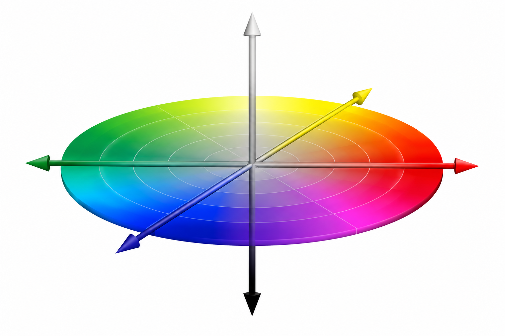

```{r setup, include=FALSE}
knitr::opts_chunk$set(
  echo = TRUE,
  message = FALSE,
  warning = TRUE,
  fig.align = "center",
  fig.width = 8,
  fig.height = 5,
  dpi = 110
)
set.seed(1702)
```

# Introducción

Una **imagen** es un arreglo de **intensidades** cuyos valores representan los **niveles de color** de cada píxel.

Una **red de adyacencia de regiones** (*Region Adjacency Graph*, RAG) describe las relaciones entre sus partes.

Una **imagen** se divide en **superpíxeles** (regiones pequeñas y relativamente homogéneas). A partir de estas regiones se construye una **red ponderada**, donde los **vértices** representan *superpíxeles* y las **aristas** conectan *regiones vecinas*, con **pesos** que cuantifican su **similitud visual**.

La idea es construir un RAG, interpretar sus medidas, detectar **regiones conectadas** y **comunidades**.

## Aplicaciones del análisis de imágenes mediante redes

El objetivo del análisis de imágenes mediante redes es **caracterizar** y **comparar** su **estructura** y **similitud visual**, mas **no reconocer objetos**.

Las medidas de red permiten estudiar la **conectividad**, la **homogeneidad del color**, la **organización espacial** y la formación de **comunidades** de superpíxeles. 

Sin embargo, estas comunidades representan regiones relacionadas visualmente y no necesariamente corresponden a objetos reconocibles de la imagen.

Algunas aplicaciones incluyen:

- **Imágenes médicas:** caracterización de regiones y patrones en tejidos.
- **Imágenes satelitales:** análisis de coberturas terrestres y cambios espaciales.
- **Control de calidad:** detección de anomalías y discontinuidades visuales.
- **Microscopía:** análisis de la organización espacial de células y tejidos.
- **Comparación de imágenes:** identificación de semejanzas y diferencias mediante **medidas estructurales de red**.

Estas técnicas describen **patrones y relaciones visuales**, pero no implican necesariamente el **reconocimiento de objetos**.


# De la imagen a la red

## Algunas concideraciones

Todas las imágenes se representan en **RGB** (intensidades de **rojo**, **verde** y **azul**), con intensidades entre **0 y 255** para cada canal (**0** indica ausencia de color y **255** su máxima intensidad).

La posición de cada **píxel** se identifica mediante su **fila** (posición vertical) y **columna** (posición horizontal).

Se consideran vecinos únicamente los píxeles que comparten un **lado** (adyacencia de cuatro vecinos).

## Superpíxeles y atributos

Cada **vértice** representa un **superpíxel**, caracterizado por su **área** (número de píxeles), **centroide** (posición central) y **color medio** en dos espacios:

- **RGB:** intensidades de **rojo**, **verde** y **azul**.
- **CIELAB:** representación perceptual mediante **L\*** (luminosidad), **a\*** (verde-rojo) y **b\*** (azul-amarillo).

```{r portada, echo=FALSE, out.width="60%"}

```

Para cuantificar la **similitud visual** entre dos **regiones vecinas**, se utiliza la **distancia euclidiana** en CIELAB, denominada **$\Delta E_{76}$**:

$$
d_{ij}=\sqrt{(\bar L_i-\bar L_j)^2+(\bar a_i-\bar a_j)^2+(\bar b_i-\bar b_j)^2},
$$

donde $(\bar L_i,\bar a_i,\bar b_i)$ representa el **color medio** del superpíxel $i$ en CIELAB. 

Cuanto menor es $d_{ij}$, mayor es la **similitud visual** entre las regiones $i$ y $j$.

## Construcción de superpíxeles

**SLIC** (*Simple Linear Iterative Clustering*) agrupa píxeles según su **similitud de color** y **proximidad espacial** para formar **superpíxeles**, mediante cuatro pasos:

1. **Inicialización:** distribuye aproximadamente `n_superpixels` centros en la imagen.
2. **Asignación:** agrupa los píxeles según su color y posición.
3. **Actualización:** recalcula los centros de cada grupo.
4. **Iteración:** repite la asignación y actualización hasta la convergencia o el límite de iteraciones.

La **distancia SLIC** combina información cromática y espacial:

$$
D=\sqrt{d_c^2+\left(\frac{m}{S}d_s\right)^2},
$$

donde:

- $d_c=\sqrt{(L_i-L_j)^2+(a_i-a_j)^2+(b_i-b_j)^2}$: **distancia de color** en CIELAB entre el píxel $i$ y el centro $j$.
- $d_s=\sqrt{(x_i-x_j)^2+(y_i-y_j)^2}$: **distancia espacial** entre sus coordenadas.
- $m$: parámetro `compactness`, que controla la **regularidad espacial**.
- $S=\sqrt{N/K}$: separación inicial aproximada entre centros, con $N$ píxeles y $K$ superpíxeles deseados (`n_superpixels`).

$(L,a,b)$ representa las **componentes CIELAB** y $(x,y)$ las **coordenadas espaciales**. 

El factor $m/S$ regula la importancia relativa de la **proximidad espacial** frente a la **similitud de color**.

`n_superpixels` determina el número aproximado de regiones. 

`compactness` regula el equilibrio entre **color** y **proximidad espacial**. Valores altos de `compactness` generan regiones más regulares; valores bajos favorecen la adaptación a los bordes de color. 

Ambos parámetros se eligen según la **resolución** y el **nivel de detalle** deseado.

## Construcción de aristas, fronteras y pesos

Dos **superpíxeles** se conectan si contienen **píxeles vecinos que comparten un lado**. 

La red resultante es **simple** (sin lazos ni aristas múltiples), **no dirigida** (conexiones recíprocas) y **espacial** (las conexiones dependen de la proximidad física en la imagen).

Cada arista tiene dos atributos:

- **Longitud de frontera ($b_{ij}$):** número de lados de píxel compartidos entre dos superpíxeles. Permite cuantificar la extensión de su contacto.
- **Similitud visual ($w_{ij}$):** mide la semejanza de color entre regiones vecinas:

$$
w_{ij}=\exp(-d_{ij}/h),\qquad h>0,
$$

donde $d_{ij}$ es la **distancia de color** y $h$ controla cómo disminuye la similitud con la distancia.

Los **pesos** $w_{ij}\in(0,1]$ se utilizan para detectar **comunidades** (grupos de superpíxeles vecinos con alta similitud visual). 

La **detección de comunidades** permite identificar grupos de **superpíxeles** con conexiones de alta **similitud visual**. Se utiliza el algoritmo **Louvain**, que busca maximizar la **modularidad** de la red ponderada.

Cada superpíxel recibe una **etiqueta de comunidad**. Estas comunidades representan agrupaciones de regiones visualmente relacionadas, aunque no necesariamente corresponden a objetos de la imagen.

Para calcular **caminos mínimos** y medidas como la **intermediación**, se define el costo $\ell_{ij}=1/w_{ij}$, de modo que las conexiones más similares tienen menor costo.

La **longitud de frontera** se conserva como atributo independiente de la similitud visual.

## Construcción 

Funciones clave:

- `prepare_rgb()`:      prepara y estandariza las imágenes.
- `image_to_graph()`:   construye la red ponderada de superpíxeles.
- `network_summary()`:  calcula las principales medidas estructurales de la red.
- `find_communities()`: identifica comunidades de superpíxeles.
- `pixel_partition()`:  proyecta las comunidades detectadas sobre la imagen original.

```{r librerias}
# Instalar una sola vez: install.packages(c("OpenImageR", "igraph", "dplyr", "ggplot2", "knitr"))
suppressMessages(suppressWarnings(library(OpenImageR)))
suppressMessages(suppressWarnings(library(igraph)))
suppressMessages(suppressWarnings(library(dplyr)))
suppressMessages(suppressWarnings(library(ggplot2)))
suppressMessages(suppressWarnings(library(knitr)))
```

```{r funciones-imagen}
# ============================================================
# 1. PREPARACIÓN DE IMÁGENES
# ============================================================

# Validar y estandarizar una imagen RGB (0-255)
prepare_rgb <- function(image,
                        max_dim = NULL,
                        scale = "auto",
                        background = c(255, 255, 255)) {

  if (is.matrix(image)) {
    image <- array(
      rep(image, 3),
      dim = c(nrow(image), ncol(image), 3)
    )
  }

  dims <- dim(image)

  if (length(dims) != 3L ||
      !dims[3] %in% c(3L, 4L) ||
      any(dims[1:2] < 2L) ||
      !is.numeric(image) ||
      any(!is.finite(image)) ||
      any(image < 0)) {
    stop("La imagen debe ser RGB/RGBA y tener al menos 2 x 2 píxeles.")
  }

  if (!is.character(scale) ||
      length(scale) != 1L ||
      is.na(scale) ||
      !scale %in% c("auto", "0-1", "0-255")) {
    stop("scale debe ser 'auto', '0-1' o '0-255'.")
  }

  if (!is.numeric(background) ||
      length(background) != 3L ||
      any(!is.finite(background)) ||
      any(background < 0 | background > 255)) {
    stop("background debe contener tres valores entre 0 y 255.")
  }

  # Convertir intensidades a 0-255
  if (scale == "auto") {
    scale <- if (max(image) <= 1) "0-1" else "0-255"
  }

  max_value <- if (scale == "0-1") 1 else 255

  if (any(image > max_value)) {
    stop("La imagen contiene valores fuera de la escala indicada.")
  }

  image <- image * (255 / max_value)

  # Componer la transparencia con el fondo
  if (dims[3] == 4L) {
    alpha <- image[, , 4] / 255
    rgb_image <- array(0, dim = c(dims[1:2], 3L))

    for (channel in seq_len(3L)) {
      rgb_image[, , channel] <-
        alpha * image[, , channel] +
        (1 - alpha) * background[channel]
    }

    image <- rgb_image
  }

  # Redimensionar sin alterar la proporción
  if (!is.null(max_dim)) {
    if (!is.numeric(max_dim) ||
        length(max_dim) != 1L ||
        !is.finite(max_dim) ||
        max_dim < 2) {
      stop("max_dim debe ser un número mayor o igual que 2.")
    }

    size <- dim(image)[1:2]

    if (max(size) > max_dim) {
      factor <- max_dim / max(size)
      new_size <- pmax(2L, round(size * factor))

      image <- OpenImageR::resizeImage(
        image,
        width = new_size[1],
        height = new_size[2],
        method = "bilinear",
        normalize_pixels = FALSE
      )
    }
  }

  image
}


# Leer una imagen de ejemplo de OpenImageR
load_example <- function(filename, max_dim = 320) {
  path <- system.file("tmp_images", filename, package = "OpenImageR")

  if (!nzchar(path)) {
    stop("No se encontró la imagen: ", filename)
  }

  prepare_rgb(
    OpenImageR::readImage(path),
    max_dim = max_dim
  )
}


# ============================================================
# 2. VISUALIZACIÓN
# ============================================================

# Mostrar una cuadrícula de píxeles coloreados
plot_pixel_colors <- function(colors, nr, nc, title = NULL) {
  pixels <- data.frame(
    x     = rep(seq_len(nc), each = nr),
    y     = rep(seq_len(nr), times = nc),
    color = as.vector(colors)
  )

  ggplot2::ggplot(pixels, ggplot2::aes(x, y, fill = color)) +
    ggplot2::geom_raster() +
    ggplot2::scale_fill_identity() +
    ggplot2::scale_y_reverse() +
    ggplot2::coord_equal(expand = FALSE) +
    ggplot2::labs(title = title) +
    ggplot2::theme_void(base_size = 12) +
    ggplot2::theme(
      plot.title = ggplot2::element_text(face = "bold", hjust = 0.5)
    )
}


# Mostrar una imagen RGB
plot_rgb <- function(image, title = NULL) {
  image <- prepare_rgb(image, scale = "0-255")

  colors <- grDevices::rgb(
    red = as.vector(image[, , 1]),
    green = as.vector(image[, , 2]),
    blue = as.vector(image[, , 3]),
    maxColorValue = 255
  )

  plot_pixel_colors(
    colors = colors,
    nr = dim(image)[1],
    nc = dim(image)[2],
    title = title
  )
}


# Mostrar una partición mediante colores discretos
plot_labels <- function(labels, title = NULL) {
  if (!is.matrix(labels) || anyNA(labels)) {
    stop("labels debe ser una matriz sin valores faltantes.")
  }

  ids <- sort(unique(as.vector(labels)))
  palette <- grDevices::hcl.colors(length(ids), palette = "Dynamic")
  colors <- setNames(palette, as.character(ids))

  plot_pixel_colors(
    colors = unname(colors[as.character(as.vector(labels))]),
    nr = nrow(labels),
    nc = ncol(labels),
    title = title
  )
}


# ============================================================
# 3. CONSTRUCCIÓN DE LA RED DE ADYACENCIA
# ============================================================

# Contar los lados de píxel compartidos por región
region_edges <- function(labels) {
  if (!is.matrix(labels) ||
      any(dim(labels) < 2L) ||
      anyNA(labels)) {
    stop("labels debe ser una matriz de al menos 2 x 2.")
  }

  nr <- nrow(labels)
  nc <- ncol(labels)

  # Comparar vecinos horizontales y verticales
  from <- c(
    as.vector(labels[, -nc, drop = FALSE]),
    as.vector(labels[-nr, , drop = FALSE])
  )

  to <- c(
    as.vector(labels[, -1, drop = FALSE]),
    as.vector(labels[-1, , drop = FALSE])
  )

  adjacent <- from != to

  edges <- data.frame(
    from = pmin(from[adjacent], to[adjacent]),
    to   = pmax(from[adjacent], to[adjacent])
  )

  if (nrow(edges) == 0L) {
    return(data.frame(
      from = integer(),
      to = integer(),
      boundary = integer()
    ))
  }

  dplyr::count(edges, from, to, name = "boundary")
}


# Construir la red ponderada de superpíxeles
image_to_graph <- function(image,
                           n_superpixels = 160,
                           compactness = 20,
                           h = 20,
                           labels_fixed = NULL) {

  image <- prepare_rgb(image, scale = "0-255")
  n_pixels <- prod(dim(image)[1:2])

  if (!is.numeric(n_superpixels) ||
      length(n_superpixels) != 1L ||
      !is.finite(n_superpixels) ||
      n_superpixels != floor(n_superpixels) ||
      n_superpixels < 2 || n_superpixels >= n_pixels) {
    stop("n_superpixels debe ser un entero entre 2 y n_píxeles - 1.")
  }

  if (!is.numeric(compactness) ||
      length(compactness) != 1L ||
      !is.finite(compactness) || compactness <= 0) {
    stop("compactness debe ser positivo.")
  }

  if (!is.numeric(h) ||
      length(h) != 1L ||
      !is.finite(h) || h <= 0) {
    stop("h debe ser positivo.")
  }

  # Calcular SLIC o reutilizar una partición fija
  if (is.null(labels_fixed)) {
    slic <- OpenImageR::superpixels(
      input_image = image,
      method = "slic",
      superpixel = n_superpixels,
      compactness = compactness,
      return_slic_data = TRUE,
      return_labels = TRUE,
      verbose = FALSE
    )

    labels <- slic$labels
    slic_image <- slic$slic_data
  } else {
    labels <- labels_fixed
    slic_image <- NULL
  }

  if (!is.matrix(labels) ||
      !identical(dim(labels), dim(image)[1:2]) ||
      !is.numeric(labels) ||
      any(!is.finite(labels)) ||
      any(labels != floor(labels))) {
    stop("Las etiquetas deben ser enteras y coincidir con la imagen.")
  }

  # Reunir atributos de cada píxel
  nr <- nrow(labels)
  nc <- ncol(labels)
  lab <- OpenImageR::RGB_to_Lab(image)

  pixels <- data.frame(
    id  = as.integer(as.vector(labels)),
    row = rep(seq_len(nr), times = nc),
    col = rep(seq_len(nc), each = nr),
    R   = as.vector(image[, , 1]),
    G   = as.vector(image[, , 2]),
    B   = as.vector(image[, , 3]),
    L   = as.vector(lab[, , 1]),
    a   = as.vector(lab[, , 2]),
    b   = as.vector(lab[, , 3])
  )

  # Resumir área, centroide y color medio
  nodes <- pixels |>
    dplyr::group_by(id) |>
    dplyr::summarise(
      x       = mean(col),
      y       = mean(row),
      area    = dplyr::n(),
      sd_L    = if (dplyr::n() > 1L) stats::sd(L) else 0,
      R       = mean(R),
      G       = mean(G),
      B       = mean(B),
      L       = mean(L),
      a       = mean(a),
      b       = mean(b),
      .groups = "drop"
    ) |>
    dplyr::arrange(id)

  # Calcular distancia y similitud entre regiones vecinas
  edges <- region_edges(labels)

  if (nrow(edges) > 0L) {
    i <- match(edges$from, nodes$id)
    j <- match(edges$to, nodes$id)

    edges$d_color <- sqrt(
      (nodes$L[i] - nodes$L[j])^2 +
      (nodes$a[i] - nodes$a[j])^2 +
      (nodes$b[i] - nodes$b[j])^2
    )

    # Evitar pesos nulos por redondeo numérico
    edges$similarity <- pmax(
      exp(-edges$d_color / h),
      .Machine$double.eps
    )

    edges$cost <- 1 / edges$similarity
  } else {
    edges$d_color <- numeric(0)
    edges$similarity <- numeric(0)
    edges$cost <- numeric(0)
  }

  # Identificar cada vértice con la etiqueta de SLIC
  vertices <- as.data.frame(nodes)
  vertices$node_color <- grDevices::rgb(
    red = vertices$R,
    green = vertices$G,
    blue = vertices$B,
    maxColorValue = 255
  )
  vertices <- data.frame(name = as.character(vertices$id), vertices)

  graph_edges <- as.data.frame(edges)
  graph_edges$from <- as.character(graph_edges$from)
  graph_edges$to <- as.character(graph_edges$to)
  graph_edges$weight <- graph_edges$similarity

  graph <- igraph::graph_from_data_frame(
    d = graph_edges,
    directed = FALSE,
    vertices = vertices
  )

  list(
    image                 = image,
    labels                = labels,
    slic_image            = slic_image,
    nodes                 = nodes,
    edges                 = edges,
    graph                 = graph,
    h                     = h,
    requested_superpixels = n_superpixels
  )
}


# ============================================================
# 4. COMUNIDADES Y COMPONENTES
# ============================================================

# Alinear una partición con el orden de los vértices
align_membership <- function(graph, membership) {
  ids <- igraph::V(graph)$name

  if (length(membership) != length(ids) || anyNA(membership)) {
    stop("La partición debe tener una etiqueta por vértice.")
  }

  if (is.null(names(membership))) {
    names(membership) <- ids
  } else {
    if (anyDuplicated(names(membership)) ||
        !setequal(names(membership), ids)) {
      stop("Los nombres de la partición no coinciden con los vértices.")
    }

    membership <- membership[ids]
  }

  membership
}


# Convertir las comunidades de vértices a etiquetas de píxeles
pixel_partition <- function(net, membership) {
  membership <- align_membership(net$graph, membership)
  labels <- membership[as.character(as.vector(net$labels))]

  matrix(
    unname(labels),
    nrow = nrow(net$labels),
    ncol = ncol(net$labels)
  )
}


# Detectar comunidades mediante Louvain o Leiden
find_communities <- function(net, method = c("louvain", "leiden")) {
  method <- match.arg(method)
  graph <- net$graph

  if (igraph::ecount(graph) == 0L) {
    return(setNames(
      seq_len(igraph::vcount(graph)),
      igraph::V(graph)$name
    ))
  }

  weights <- igraph::E(graph)$weight

  communities <- if (method == "louvain") {
    igraph::cluster_louvain(
      graph,
      weights = weights
    )
  } else {
    igraph::cluster_leiden(
      graph,
      objective_function = "modularity",
      weights = weights
    )
  }

  align_membership(graph, igraph::membership(communities))
}


# Eliminar aristas con similitud inferior al umbral
filter_graph <- function(net, tau = 0.50) {
  if (!is.numeric(tau) ||
      length(tau) != 1L ||
      !is.finite(tau) ||
      tau < 0 || tau > 1) {
    stop("tau debe estar entre 0 y 1.")
  }

  graph <- net$graph
  remove <- which(igraph::E(graph)$weight < tau)

  igraph::delete_edges(graph, remove)
}


# Resumir componentes por vértices y por área de píxeles
component_stats <- function(net, tau = 0.50) {
  graph <- filter_graph(net, tau)
  components <- igraph::components(graph)
  areas <- igraph::V(graph)$area

  area_by_component <- rowsum(
    x = areas,
    group = components$membership,
    reorder = FALSE
  )

  data.frame(
    components           = components$no,
    largest_vertex_share = max(components$csize) / igraph::vcount(graph),
    largest_area_share   = max(area_by_component) / sum(areas)
  )
}


# ============================================================
# 5. RESUMEN DE LA RED
# ============================================================

# Calcular medidas sin volver a detectar comunidades
network_summary <- function(net, membership, tau = 0.50) {
  graph <- net$graph
  membership <- align_membership(graph, membership)

  weights <- igraph::E(graph)$weight
  degree <- igraph::degree(graph)
  strength <- igraph::strength(graph, weights = weights)
  transitivity <- igraph::transitivity(graph, type = "global")

  # Separar similitud promedio y número de vecinos
  mean_local_similarity <- if (any(degree > 0)) {
    mean(strength[degree > 0] / degree[degree > 0])
  } else {
    NA_real_
  }

  modularity <- if (length(weights) > 0L) {
    igraph::modularity(graph, unname(membership), weights = weights)
  } else {
    NA_real_
  }

  data.frame(
    target_n              = net$requested_superpixels,
    vertices              = igraph::vcount(graph),
    edges                 = igraph::ecount(graph),
    mean_degree           = mean(degree),
    density               = igraph::edge_density(graph),
    transitivity          = if (is.finite(transitivity)) transitivity else NA_real_,
    mean_similarity       = if (length(weights)) mean(weights) else NA_real_,
    mean_local_similarity = mean_local_similarity,
    communities           = length(unique(membership)),
    modularity            = modularity,
    component_stats(net, tau)
  )
}


# ============================================================
# 6. VISUALIZACION
# ============================================================

# 1. Visualizar las fronteras entre superpíxeles
plot_superpixels <- function(net, title = "Fronteras SLIC") {

  labels <- net$labels
  nr     <- nrow(labels)
  nc     <- ncol(labels)

  # Identificar fronteras horizontales y verticales
  boundary <- matrix(FALSE, nrow = nr, ncol = nc)

  boundary[, -nc] <- boundary[, -nc] |
    (labels[, -nc] != labels[, -1])

  boundary[-nr, ] <- boundary[-nr, ] |
    (labels[-nr, ] != labels[-1, ])

  # Dibujar las fronteras en negro
  image <- net$image

  for (channel in seq_len(3)) {
    layer <- image[, , channel]
    layer[boundary] <- 0
    image[, , channel] <- layer
  }

  plot_rgb(
    image = image,
    title = title
  )
}


# 2. Visualizar la red sobre la imagen
plot_graph <- function(net, title = "Red espacial",
                       show_image = TRUE) {

  nodes <- net$nodes
  edges <- net$edges

  # Seleccionar la imagen de fondo
  p <- if (show_image) {
    plot_rgb(net$image, title)
  } else {
    plot_labels(net$labels, title)
  }

  # Dibujar conexiones entre centroides
  if (nrow(edges) > 0) {

    i <- match(edges$from, nodes$id)
    j <- match(edges$to,   nodes$id)

    edges$x    <- nodes$x[i]
    edges$y    <- nodes$y[i]
    edges$xend <- nodes$x[j]
    edges$yend <- nodes$y[j]

    p <- p +
      geom_segment(
        data        = edges,
        mapping     = aes(
          x         = x,
          y         = y,
          xend      = xend,
          yend      = yend,
          linewidth = similarity
        ),
        inherit.aes = FALSE,
        color       = "#222222",
        alpha       = 0.6,
        show.legend = FALSE
      ) +
      scale_linewidth(range = c(0.2, 1.2))
  }

  # Dibujar los vértices
  p +
    geom_point(
      data        = nodes,
      mapping     = aes(x = x, y = y),
      inherit.aes = FALSE,
      color       = "white",
      size        = 1.1
    )
}


# 3. Visualizar las comunidades sobre la imagen
plot_communities <- function(net, membership,
                             title = "Comunidades") {

  # Asignar una comunidad a cada píxel
  partition <- pixel_partition(
    net        = net,
    membership = membership
  )

  # Visualizar la segmentación
  plot_labels(
    labels = partition,
    title  = title
  )
}


# 4. Evaluar la fragmentación según el umbral
threshold_table <- function(net, tau = seq(0, 0.95, by = 0.05)) {

  # Calcular componentes para cada umbral
  results <- lapply(tau, function(t) {

    stats <- component_stats(
      net = net,
      tau = t
    )

    data.frame(
      tau = t,
      stats
    )
  })

  # Consolidar resultados
  dplyr::bind_rows(results)
}
```


# Paisaje

## Construir y explorar el RAG

```{r paisaje}
# Imagen y red
img_landscape <- load_example("landscape.jpg")
net_landscape <- image_to_graph(img_landscape, n_superpixels = 180, compactness = 20, h = 20)

print(plot_rgb(img_landscape, "Paisaje original"))
print(plot_superpixels(net_landscape))
print(plot_graph(net_landscape))

# Número solicitado frente al obtenido
c(solicitados = 180, obtenidos = igraph::vcount(net_landscape$graph))
```
Las **aristas** muestran **adyacencia**; su grosor indica **similitud**.

La **tabla de aristas** describe las conexiones entre **superpíxeles vecinos**. Cada arista registra sus extremos (`from`, `to`), la **longitud de frontera compartida** (`boundary`), la **distancia de color** (`d_color`), la **similitud visual** (`similarity`) y el **costo de recorrido** (`cost`). Una mayor similitud implica un menor costo.

```{r pesos}
# Distribución de distancias y similitudes
knitr::kable(head(net_landscape$edges, 8), digits = 3)

ggplot(net_landscape$edges, aes(x = similarity)) +
  geom_histogram(bins = 25, fill = "#356d89", color = "white") +
  labs(x = "Similitud entre vecinos", y = "Frecuencia") +
  theme_minimal(base_size = 12)
```

## Filtrado y componentes


El **filtrado de aristas** conserva únicamente las conexiones con **similitud visual** $w_{ij}\geq\tau$, eliminando las más débiles. 

El **umbral** $\tau$ y el parámetro $h$ determinan la **distancia máxima de color** permitida:

$$
w_{ij}\geq\tau
\quad\Longleftrightarrow\quad
d_{ij}\leq-h\log\tau,
\qquad 0<\tau\leq1.
$$

Para $h=20$, los umbrales $\tau=0.30$, $0.50$ y $0.70$ equivalen a distancias máximas de color de $24.08$, $13.86$ y $7.13$, respectivamente. 

**Cuanto mayor es $\tau$, más estricto es el filtrado**.

```{r filtrado}
# Resumen del filtrado en tres umbrales
thresholds <- c(0.30, 0.50, 0.70)
knitr::kable(threshold_table(net_landscape, thresholds), digits = 3)

# Evolución de la componente mayor, ponderada por área
curve <- threshold_table(net_landscape)
ggplot(curve, aes(tau, largest_area_share)) +
  geom_line(linewidth = 1, color = "#356d89") +
  geom_point(size = 1.5) +
  labs(x = "Umbral de similitud", y = "Fracción de píxeles",
       title = "Área de la componente más grande") +
  theme_minimal(base_size = 12)
```

La tabla muestra la **fragmentación de la red** según el **umbral de similitud** $\tau$. Se reportan el número de **componentes conexas** (`components`) y la proporción de **superpíxeles** (`largest_vertex_share`) y **área de la imagen** (`largest_area_share`) pertenecientes a la **componente más grande**. 

Al aumentar $\tau$, se eliminan más aristas, aumentando la fragmentación de la red.

Una **componente** reúne superpíxeles unidos por un **camino** de aristas conservadas. No exige que todos sus colores sean iguales y no identifica necesariamente un objeto.

```{r componentes-mapa}
# Representación espacial de las componentes filtradas
landscape_components <- igraph::components(filter_graph(net_landscape, 0.50))
print(plot_labels(
  pixel_partition(net_landscape, landscape_components$membership),
  "Componentes: tau = 0.50"
))
```

## Centralidad

El **grado** mide el número de vecinos de un vértice. 

La **fuerza** mide la suma de las similitudes de sus conexiones. 

La **intermediación** mide su participación en los caminos mínimos. Esta se calcula utilizando **costos** $\ell_{ij}=1/w_{ij}$ o considerando todas las aristas con igual longitud, para comparar la intermediación **ponderada y no ponderada**.

```{r centralidad}
# Comparar centralidades con distintas convenciones de caminos
landscape_g <- net_landscape$graph
k <- igraph::degree(landscape_g)
s <- igraph::strength(landscape_g, weights = igraph::E(landscape_g)$weight)
centralities <- data.frame(
  id = igraph::V(landscape_g)$name,
  degree = k,
  strength = s,
  mean_neighbor_similarity = ifelse(k > 0, s / pmax(k, 1), NA_real_),
  betweenness = igraph::betweenness(
    landscape_g, directed = FALSE, weights = NA, normalized = TRUE
  ),
  betweenness_cost = igraph::betweenness(
    landscape_g, directed = FALSE,
    weights = igraph::E(landscape_g)$cost, normalized = TRUE
  )
)
knitr::kable(head(centralities[order(-centralities$betweenness_cost), ], 10),
             digits = 3)
```


La tabla presenta los **10 superpíxeles con mayor intermediación ponderada**, junto con su **grado** (`degree`), **fuerza** (`strength`), **similitud media con sus vecinos** (`mean_neighbor_similarity`) e **intermediación no ponderada** (`betweenness`) y **ponderada** (`betweenness_cost`). 

Su comparación permite evaluar cómo influye la **similitud visual** en la importancia estructural de cada región.

```{r centralidad-filtrada}
# Intermediación después del filtrado por similitud
filtered_g <- filter_graph(net_landscape, tau = 0.50)
centralities$betweenness_filtered <- igraph::betweenness(
  filtered_g, directed = FALSE, weights = igraph::E(filtered_g)$cost,
  normalized = TRUE
)
knitr::kable(head(centralities[order(-centralities$betweenness_filtered), ], 8),
             digits = 3)
```

La tabla presenta los **8 superpíxeles con mayor intermediación en la red filtrada**, comparando sus medidas de **centralidad** antes y después del filtrado. 

El objetivo es identificar regiones cuya importancia como **puentes estructurales** cambia al eliminar conexiones con baja **similitud visual**.

## Comunidades: Louvain y Leiden

**Louvain** y **Leiden** detectan **comunidades** maximizando la **modularidad ponderada**, que favorece grupos con conexiones relativamente fuertes. 

A diferencia de Louvain, **Leiden** garantiza comunidades internamente conectadas. Sin embargo, una **modularidad alta** no implica necesariamente una **segmentación correcta** de la imagen.

```{r comunidades}
# Calcular cada partición una sola vez
landscape_louvain <- find_communities(net_landscape, "louvain")
landscape_leiden <- find_communities(net_landscape, "leiden")

print(plot_communities(net_landscape, landscape_louvain, "Louvain"))
print(plot_communities(net_landscape, landscape_leiden, "Leiden"))

# Comparar número de grupos y modularidad
knitr::kable(dplyr::bind_rows(
  data.frame(method = "Louvain", network_summary(
    net_landscape, landscape_louvain, tau = 0.50)),
  data.frame(method = "Leiden", network_summary(
    net_landscape, landscape_leiden, tau = 0.50))
), digits = 3)
```


La tabla presenta las principales **características estructurales** de la red y los resultados de la **detección de comunidades**:

- **Construcción de la red:** `method` identifica el algoritmo utilizado; `target_n`, el número objetivo de superpíxeles; `vertices`, el número obtenido; y `edges`, las conexiones entre ellos.
- **Estructura de la red:** `mean_degree` representa el grado medio; `density`, la densidad; y `transitivity`, la transitividad global.
- **Similitud visual:** `mean_similarity` mide la similitud media de las aristas y `mean_local_similarity`, el promedio de las similitudes medias de los vértices con sus vecinos.
- **Comunidades:** `communities` indica el número de comunidades detectadas y `modularity`, la modularidad ponderada de la partición.
- **Conectividad:** `components` representa el número de componentes conexas después del filtrado; `largest_vertex_share`, la proporción de superpíxeles en la componente más grande; y `largest_area_share`, la proporción del área de la imagen que representa.

La tabla compara **Louvain** y **Leiden** sobre una misma **red ponderada**, describiendo sus propiedades estructurales y las particiones obtenidas. 

**Louvain** identifica 8 comunidades (modularidad 0.702), mientras que **Leiden** identifica 7 (modularidad 0.714). 

Ambos presentan resultados similares, aunque una mayor **modularidad** no garantiza una mejor **segmentación visual**.

# Otras imágenes

Para comparar imágenes usamos **la misma regla de construcción**, aunque el número efectivo de superpíxeles y su geometría pueden variar.

```{r otras-imagenes}
# Imágenes del paquete OpenImageR
img_car     <- load_example("car.png")
img_complex <- load_example("slic_im.png")

# Misma configuración para los tres casos
net_car        <- image_to_graph(img_car, 180, 20, 20)
net_complex    <- image_to_graph(img_complex, 180, 20, 20)
car_groups     <- find_communities(net_car)
complex_groups <- find_communities(net_complex)

print(plot_rgb(img_car, "Automóvil"))
print(plot_communities(net_car, car_groups, "Comunidades: automóvil"))
print(plot_rgb(img_complex, "Escena compleja"))
print(plot_communities(net_complex, complex_groups, "Comunidades: escena compleja"))
```

```{r comparacion-imagenes}
# Comparar estructura y similitud, no reconocer objetos
comparison <- dplyr::bind_rows(
  data.frame(image = "Paisaje", network_summary(net_landscape, landscape_louvain)),
  data.frame(image = "Automóvil", network_summary(net_car, car_groups)),
  data.frame(image = "Compleja", network_summary(net_complex, complex_groups))
)
knitr::kable(comparison, digits = 3)
```

**Comparar estructura y similitud, no reconocer objetos.**

**densidad**, **grado** y **transitividad** están condicionados por SLIC y por la geometría de la imagen. No son índices directos de **homogeneidad visual**.

# Imagen sintética con verdad conocida

La **verdad de referencia** permite evaluar las comunidades **fuera del propio grafo**. 

Usaremos cuatro regiones, con intensidades controladas y posibles perturbaciones.

```{r generador}
# Generar cuatro cuadrantes; evita saturación del contraste estudiado
simulate_regions <- function(nr = 96, nc = 96, contrast = 60,
                             noise_sd = 0) {
  if (nr < 4 || nc < 4 || contrast < 0 || contrast > 100 || noise_sd < 0) {
    stop("Revisar dimensiones, contraste [0,100] y ruido.")
  }

  # Etiquetas verdaderas en cuatro cuadrantes
  rows <- matrix(rep(seq_len(nr), nc), nrow = nr)
  cols <- matrix(rep(seq_len(nc), each = nr), nrow = nr)
  truth <- 1L + (cols > floor(nc / 2)) +
    2L * (rows > floor(nr / 2))

  # Los colores son idénticos si contrast = 0
  base <- 100
  colors <- rbind(
    c(base + contrast, base, base),
    c(base, base + contrast, base),
    c(base, base, base + contrast),
    c(base + contrast, base + contrast, base)
  )

  image <- array(0, dim = c(nr, nc, 3))
  for (channel in seq_len(3)) {
    image[, , channel] <- matrix(colors[as.vector(truth), channel], nr, nc)
  }

  # Añadir ruido gaussiano antes del recorte a [0,255]
  if (noise_sd > 0) {
    image <- image + array(rnorm(length(image), sd = noise_sd), dim(image))
  }
  clipped <- mean(image < 0 | image > 255)
  image <- pmin(pmax(image, 0), 255)

  list(image = image, truth = truth, clipped_share = clipped)
}

# Escena de referencia con cuatro regiones
scene <- simulate_regions(contrast = 60)
net_scene <- image_to_graph(scene$image, n_superpixels = 90)
scene_groups <- find_communities(net_scene)

print(plot_rgb(scene$image, "Imagen sintética"))
print(plot_labels(scene$truth, "Segmentación"))
print(plot_superpixels(net_scene, "Superpíxeles"))
print(plot_communities(net_scene, scene_groups, "Comunidades detectadas"))
```


# Evaluación y extensiones

## Evaluación de la segmentación

La **calidad de las comunidades detectadas** puede evaluarse mediante dos enfoques:

- **Evaluación interna:** utiliza medidas como la **modularidad**, que cuantifica la organización de las comunidades dentro de la red.
- **Evaluación externa:** compara las comunidades con una **segmentación verdadera**, mediante el **índice de Rand ajustado (ARI)**, la **intersección sobre unión (IoU)** y el **F1 de fronteras**.

Una **modularidad alta** no garantiza una segmentación correcta. La evaluación externa requiere conocer las regiones verdaderas, como ocurre con las imágenes simuladas.

## Análisis de sensibilidad

Los resultados dependen de las decisiones utilizadas para construir la red:

- **Número de superpíxeles:** controla la resolución espacial del análisis.
- **Compactación (`compactness`):** regula la regularidad de los superpíxeles.
- **Escala de similitud ($h$):** determina cómo disminuyen los pesos con la distancia de color.
- **Umbral ($\tau$):** controla el filtrado de aristas y la fragmentación de la red.

El **análisis de sensibilidad** permite identificar qué resultados permanecen estables ante cambios en estos parámetros.

## Robustez ante perturbaciones

Es posible estudiar cómo cambia la red cuando se modifica la imagen mediante:

- **Ruido:** introduce variaciones aleatorias en las intensidades.
- **Suavizado:** reduce variaciones locales, pero puede difuminar fronteras.
- **Iluminación:** modifica las intensidades y potencialmente las similitudes.
- **Rotación y escala:** modifican la representación espacial y pueden afectar la partición en superpíxeles.

La **robustez** se evalúa comparando las medidas estructurales y las comunidades antes y después de las transformaciones.

## Estudios de simulación

Las **imágenes simuladas** permiten conocer la segmentación verdadera y evaluar el desempeño de los métodos bajo condiciones controladas.

Se pueden estudiar los efectos del **contraste**, el **ruido** y la **resolución** sobre la conectividad, la modularidad y la recuperación de regiones.

Dos estrategias permiten distinguir las fuentes de variación:

- **SLIC fijo:** conserva los superpíxeles originales y modifica únicamente sus atributos visuales y los pesos de la red.
- **SLIC variable:** recalcula los superpíxeles después de cada perturbación.

Mediante **simulaciones Monte Carlo**, se pueden comparar promedios, variabilidad y estabilidad de las medidas de red y de la segmentación.

## Otras extensiones

El análisis de imágenes mediante redes puede ampliarse en diferentes direcciones:

- **Atributos visuales:** incorporar textura, gradientes y longitud de fronteras compartidas.
- **Agrupamiento:** comparar Louvain y Leiden con métodos espectrales y cortes de grafos.
- **Análisis multiescala:** estudiar redes construidas con diferentes resoluciones de superpíxeles.
- **Procesamiento de señales en grafos:** utilizar el Laplaciano para suavizar o identificar variaciones espaciales.
- **Comparación de imágenes:** utilizar características estructurales de sus redes para estudiar semejanzas y diferencias.

Estas extensiones permiten pasar de la **caracterización estructural** a problemas más generales de **segmentación, comparación y procesamiento de imágenes**.


# Referencias

- Achanta, R. et al. (2012). *SLIC superpixels compared to state-of-the-art superpixel methods*. IEEE TPAMI, 34(11), 2274–2282. https://doi.org/10.1109/TPAMI.2012.120
- Blondel, V. D. et al. (2008). *Fast unfolding of communities in large networks*. Journal of Statistical Mechanics, P10008. https://doi.org/10.1088/1742-5468/2008/10/P10008
- Traag, V. A., Waltman, L., & van Eck, N. J. (2019). *From Louvain to Leiden: guaranteeing well-connected communities*. Scientific Reports, 9, 5233. https://doi.org/10.1038/s41598-019-41695-z
- Felzenszwalb, P. F., & Huttenlocher, D. P. (2004). *Efficient graph-based image segmentation*. International Journal of Computer Vision, 59, 167–181. https://doi.org/10.1023/B:VISI.0000022288.19776.77
- Shi, J., & Malik, J. (2000). *Normalized cuts and image segmentation*. IEEE TPAMI, 22(8), 888–905. https://doi.org/10.1109/34.868688
- `OpenImageR`: https://CRAN.R-project.org/package=OpenImageR
- `igraph`: https://r.igraph.org/

